  

  

  
  
  

  

<table align="center">
  <tr>
    <td align="center">🎓 <b>HCMUTE</b> Faculty of IT</td>
    <td align="center">🎨 <b>Frontend</b> React · UI / UX</td>
    <td align="center">🤖 <b>Exploring AI</b> RAG · Agents · MCP</td>
    <td align="center">🎮 <b>Game Dev</b> Unity 6 · 3D</td>
    <td align="center">📍 <b>Ho Chi Minh City</b> Vietnam</td>
  </tr>
</table>

<table align="center">
  <tr><td align="right"><b>🎨 Frontend</b></td><td></td></tr>
  <tr><td align="right"><b>💻 Languages</b></td><td></td></tr>
  <tr><td align="right"><b>⚙️ Backend · DB</b></td><td></td></tr>
  <tr><td align="right"><b>🎮 Game · AI · Cloud</b></td><td></td></tr>
  <tr><td align="right"><b>🧰 Tools</b></td><td></td></tr>
</table>

  

<table>
  <tr>
    <td width="50%" valign="top">
      <h3>🦸 MARVEL Vision</h3>
      
Transform into <b>51 characters</b> (30 Marvel heroes, 12 villains, 9 DC) with <b>just your hand gestures</b> on a webcam — real-time hand, pose & face tracking, segmentation, bloom effects and live synthesized sound.

      
      
      
      
    </td>
    <td width="50%" valign="top">
      <h3>🐷 PIG-Simulator</h3>
      
Open-world 3D pig-farm game — breed rare pigs, hunting mode, village hub & room-based co-op (2–4 players). Personal project.

      
      
      
      
    </td>
  </tr>
  <tr>
    <td width="50%" valign="top">
      <h3>📚 <a href="https://github.com/TPhPlyFking/ilearning-school">iLearning School</a></h3>
      
React frontend for an online learning platform, fully integrated with backend REST APIs.

      
      
      
    </td>
    <td width="50%" valign="top">
      <h3>🏢 Apartment Selling Website</h3>
      
Apartment sale/rental platform for HCMC — listings, property details, posting, viewing appointments & notifications. Deployed on Render.

      
      
      
      
    </td>
  </tr>
  <tr>
    <td width="50%" valign="top">
      <h3>🤖 <a href="https://github.com/TPhPlyFking/Training-Score-Agents">Training Score Agent</a></h3>
      
AI assistant for student training scores using RAG + Agent + MCP. My role: Data & Retrieval (chunking, hybrid search, evaluation).

      
      
      
    </td>
    <td width="50%" valign="top">
      <h3>✋ GestureFlow</h3>
      
Real-time hand gesture control for computers. My part: the mouse & keyboard control module.

      
      
    </td>
  </tr>
  <tr>
    <td width="50%" valign="top">
      <h3>🍬 <a href="https://github.com/TPhPlyFking/CoalOrCandy">CoalOrCandy</a></h3>
      
Group web project (Group 6 – IT K24).

      
      
    </td>
    <td width="50%" valign="top">
      <h3>☁️ <a href="https://github.com/TPhPlyFking/Lab01-Cloud">Lab01-Cloud</a></h3>
      
Static website deployed to the cloud — Cloud Computing course lab.

      
      
      
    </td>
  </tr>
</table>

  

<h3 align="center">🚀 Latest Launches <i>(auto-updated)</i></h3>

<!--REPOS:START-->
| 🪐 Repository | 📝 Description | 💻 Language | ⭐ |
|---|---|---|---|
| [Realtime-Hand-Gesture](https://github.com/TPhPlyFking/Realtime-Hand-Gesture) | — | Python | 0 |
| [Lab01-Cloud](https://github.com/TPhPlyFking/Lab01-Cloud) | — | CSS | 0 |
| [ilearning-school](https://github.com/TPhPlyFking/ilearning-school) | — | CSS | 0 |
| [Training-Score-Agents](https://github.com/TPhPlyFking/Training-Score-Agents) | — | Python | 0 |
| [sendMail](https://github.com/TPhPlyFking/sendMail) | — | Java | 0 |
| [java-mvc-email-list-web-week1](https://github.com/TPhPlyFking/java-mvc-email-list-web-week1) | — | Java | 0 |
<!--REPOS:END-->

<b>📦 More C++ / Java projects</b>

 

- 🏥 [Hospital](https://github.com/TPhPlyFking/Hospital) — hospital management (C++)
- 🏦 [Bank Account Management System](https://github.com/TPhPlyFking/Bank-Account-Management-System) (C++)
- 🛒 [E-commerce Product Management System](https://github.com/TPhPlyFking/-E-commerce-Product-Management-System) (C++)
- 🚌 [Public Transportation Station Management System](https://github.com/TPhPlyFking/Public-Transportation-Station-Management-System) (C++)
- 🚗 [Vehicle](https://github.com/TPhPlyFking/vehicle) (C++)
- ✉️ [sendMail](https://github.com/TPhPlyFking/sendMail) & [Java MVC Email List Web](https://github.com/TPhPlyFking/java-mvc-email-list-web-week1) (Java)

  

  
  

  
  

  

  

  <picture>
    <source media="(prefers-color-scheme: dark)" srcset="https://raw.githubusercontent.com/TPhPlyFking/TPhPlyFking/output/pacman-contribution-graph-dark.svg" />
    
  </picture>

  

  

